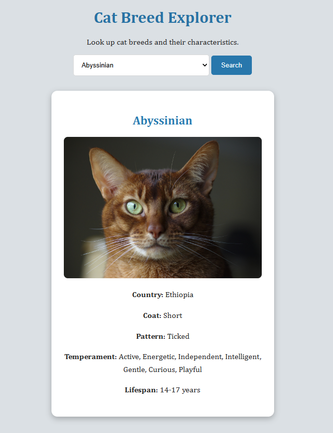

# Cat Breed Explorer

An interactive web application that allows users to explore cat breeds and learn about their characteristics through a simple, searchable interface.

Built with HTML, CSS, and JavaScript, the application combines data from multiple APIs to display breed information, temperament, lifespan, and photos in one place.

## Live Demo

**[Explore Cat Breeds](https://anwaralshohatee.github.io/vet-app/)**

## Technologies


## Features

- Browse cat breeds using a dropdown menu
- Retrieve breed characteristics from the Cat Facts API
- Display breed origin, coat type, and pattern
- Retrieve temperament and lifespan information from The Cat API
- Display a matching cat breed photo
- Dynamically update results without reloading the page
- Handle missing selections and unavailable breed information
- Present results in a clean, responsive card layout

## Screenshot



## How It Works

1. Select a cat breed from the dropdown menu.
2. Click **Search**.
3. The application retrieves breed characteristics from the Cat Facts API.
4. It searches The Cat API for additional breed information.
5. Using the matching breed ID, it requests a breed photo.
6. The application displays the combined information in a single result card.

## APIs Used

### Cat Facts API

Provides the list of cat breeds and information such as country of origin, coat, and pattern.

https://catfact.ninja/

### The Cat API

Provides additional breed details, including temperament, lifespan, and breed-specific images.

https://thecatapi.com/

## Getting Started

### 1. Clone the Repository

```bash
git clone https://github.com/AnwarAlshohatee/vet-app.git
cd vet-app
```

### 2. Run the Application

Open `index.html` in your browser.

No build process or package installation is required.

An internet connection and working API access are required to retrieve breed information and images.

## Future Improvements

- Add a text-based breed search
- Allow users to compare multiple breeds
- Add filtering by temperament or coat type
- Improve API error handling
- Add loading indicators for images
- Improve accessibility and mobile responsiveness

## Author

**Anwar Alshohatee**

[Portfolio](https://anwaralshohatee.netlify.app) | [LinkedIn](https://www.linkedin.com/in/anwaralshohatee/)
